# Lab sheet 2: Answers        
 *One pipeline, five gates, and four defects you did not write*

### Team Members:
- **Benrahmoune Israa** 
- **Boucherit Meriem**
- **Houdaci Lina Yacemine**
- **Mechraoui Aya**

--------

### Exercise 01:

- **(a)** The pull_request trigger runs the pipeline when a **proposed change** is submitted for review, **before** it is **merged** into the **main branch**. This helps **detect problems early** and allows the team to **review** the results before **accepting the changes**. A push trigger runs **after** commits are **pushed** to the specified branch.

- **(b)** Lint runs before the tests because it is a **fast check** that can detect **formatting and code-quality problems early**. If lint **fails**, the team can **fix** those issues before **spending time** running the tests.

- **(c)** This order becomes more important when the test suite takes 20 minutes. Running lint **first** can **quickly identify** simple problems and avoid **wasting time** waiting for a **long test run** when the code already has linting errors.

----------
### Exercise 02:

- **(a)** The command that skips Git hooks during a commit is: `git commit --no-verify`

- **(b)**  **A contributor who has permission** to push changes could **still attempt** to introduce a **secret** by **bypassing the local pre-commit hook**. However, the CI pipeline **scans** the changes, and branch protection **prevents** the pull request from being merged when the required check **fails**. Therefore, a secret detected by the pipeline should **not reach main** through the normal **protected workflow**.

----------
### Exercise 03:

- **(a)** The error line from the failed pipeline was:

  `ModuleNotFoundError: No module named 'scoreboard'`

- **(b)** The project uses a src layout, meaning the scoreboard package is **stored inside** the src directory rather than **directly** at the repository root. Without installing the project, Python may **not** have the package’s location in its **import path**, so the tests **cannot** import scoreboard.

- **(c)**  The command that ran the installation for me was: `pip install -e .`

----------
### Exercise 04:

The following table summarizes the four defects based on the pipeline log. just like it was mentionned on the diagnosis file too!

| Defect | Gate that failed | Name in the log | One-line cause |
|---|---|---|---|
| **Test 1** | tests | tests/test_api.py::test_submitting_for_an_unknown_team_is_not_found | submit uses team.id when the lookup returned None; unknown team is not handled (expected 404) |
| **Test 2** | tests | tests/test_scoring.py::test_last_solve_time_is_the_most_recent_not_the_last_added | last_solve_time returns the last record of the list (12:05) instead of the latest time (12:30) |
| **Credential** | secret scan | gitleaks: leaks found: 2 (no rule or file shown in the log) | a secret-like value is committed in the repository |
| **Dependency** | dependency audit | idna 3.6: PYSEC-2024-60, PYSEC-2026-215 | vulnerable pinned dependency; fixed in 3.7 and 3.15 |

How each test failed:

- **Test 1**: by exception ( `AttributeError: 'NoneType' object has no attribute 'id'` )
- **Test 2**: by assertion ( `AssertionError: 12:05 is not equal to 12:30` )

---------
### Exercise 05:

- **(a)**  It’s a **transitive dependency**( after the fixes ). It isn’t in the project’s **own dependency list**, it’s installed because other packages **need it**, such as `requests`, which is a **direct dependency**.

- **(b)** I checked the dependency relationship running the command:`.venv/bin/pip show idna`. andother teammate used the command: `pipdeptree -r -p idna` .
  
  The `-r` flag means **“reverse”**: it starts from **idna** and lists what **requires it**.

  The `Required-by:` line lists `anyio, httpx, requests` which shows that other packages pull it in. And results of the second command also proved this ( shown on the very last screenshot below! )
------

### Screenshots Links:
#### Part A:
We didn't take proper screenshots of the steps since everything was already given in the labsheet and the pipline is working fine (shown in the repo)

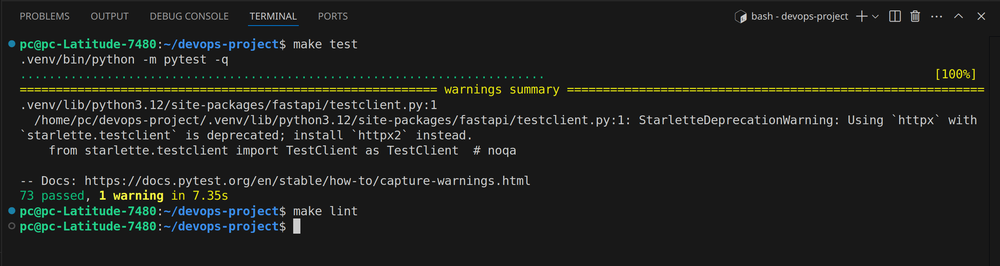

#### Part B:
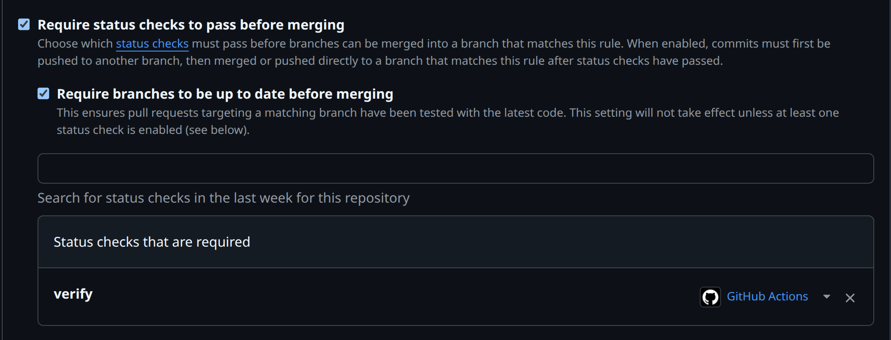

#### Part C:
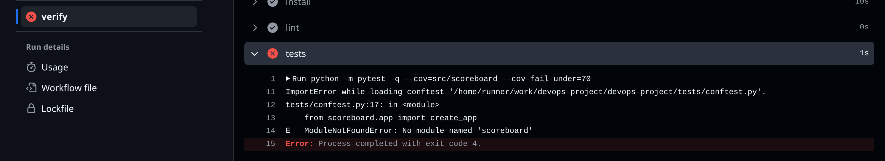

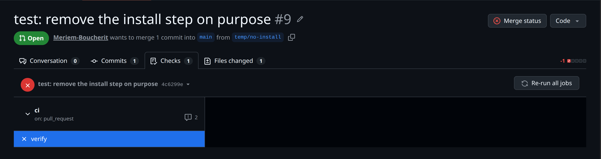

#### Part D:
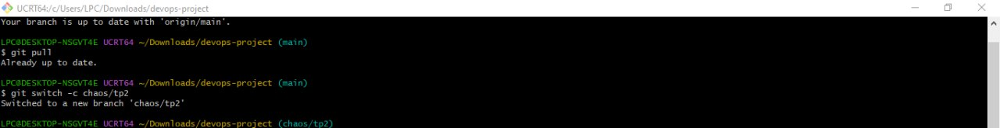

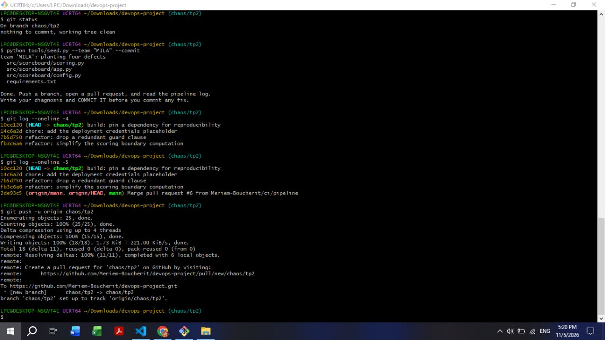

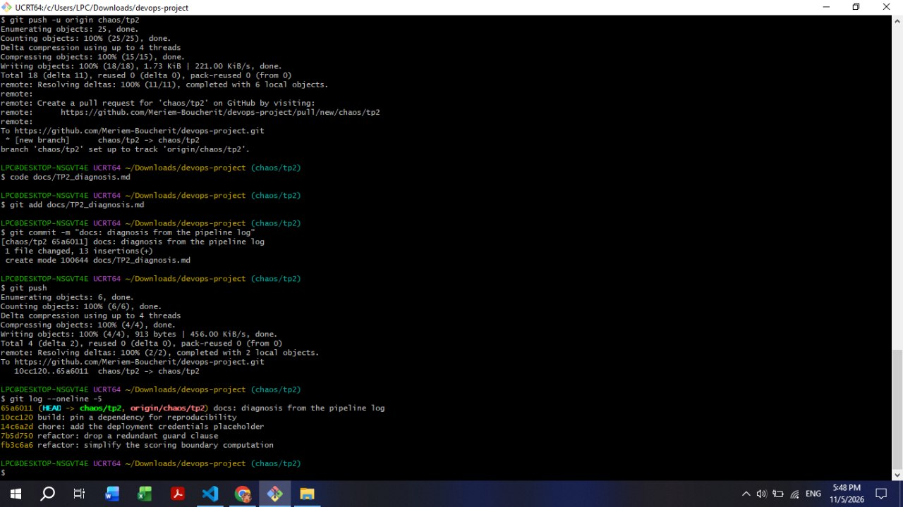

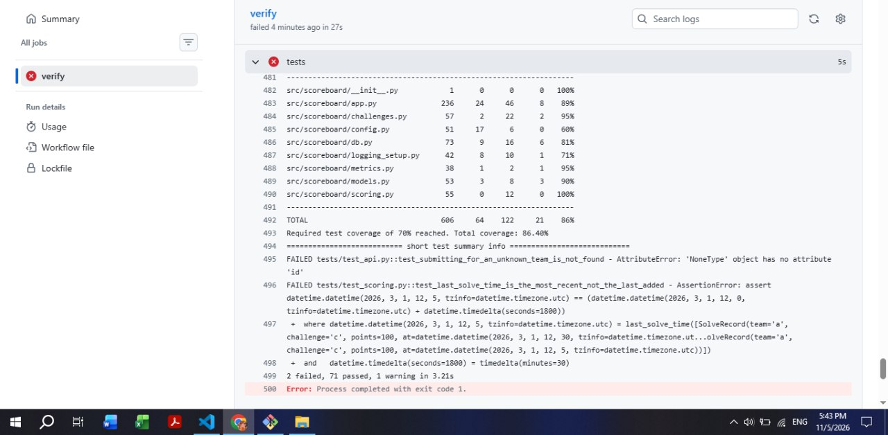

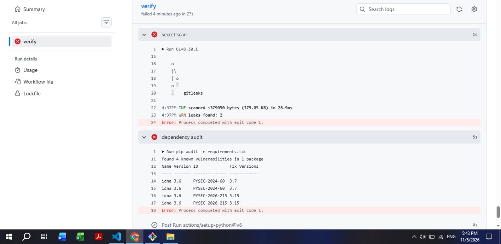

#### Repairing Defects Part: 
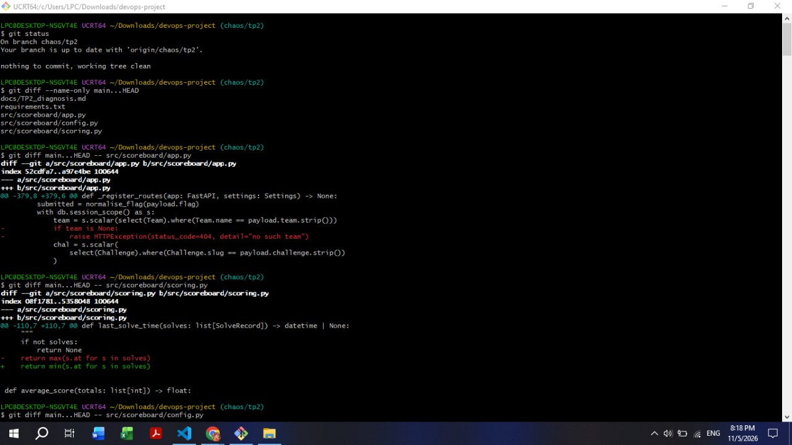

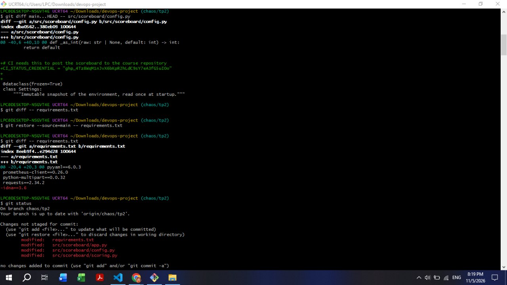

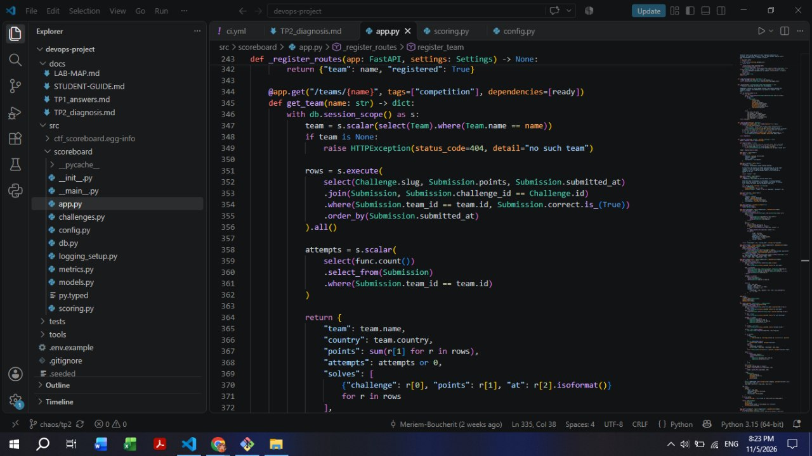

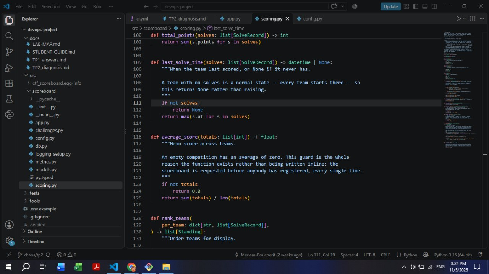

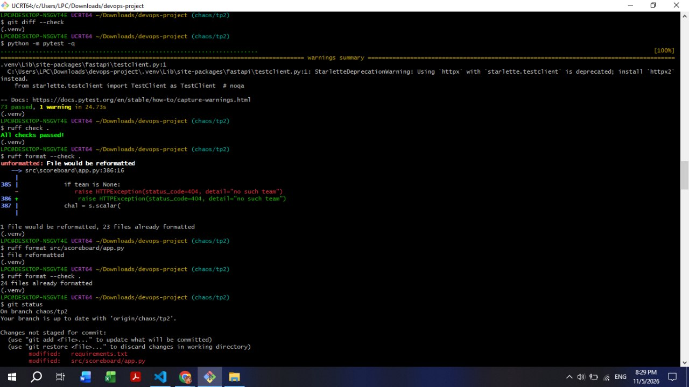

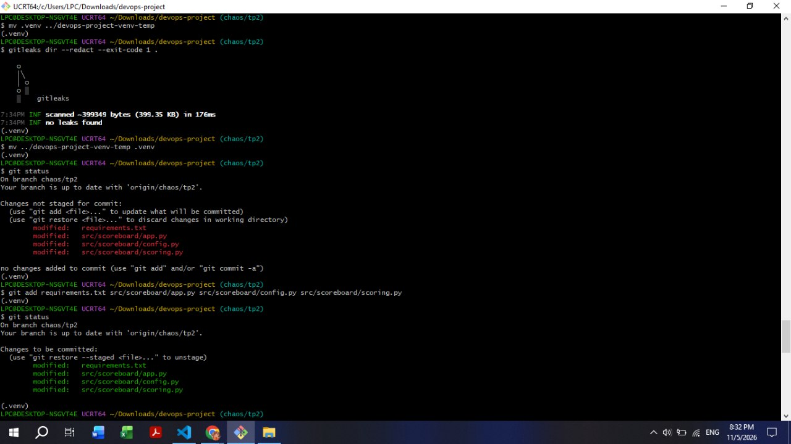

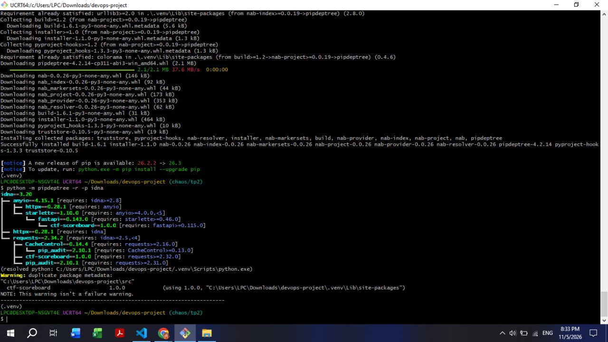

