# Lab sheet 3: Answers        
 *A small, non-root image, run hardened, scanned and published by the pipeline*

### Team Members:
- **Benrahmoune Israa** 
- **Boucherit Meriem**
- **Houdaci Lina Yacemine**
- **Mechraoui Aya**

--------

### Exercise 01:

- **(a)** The size of `scoreboard:local` is: **266MB**
     and the size of `python:3.12-slim` is: **179MB**

- **(b)** Two things present in the build stage but absent from the final runtime image are:
  -  **The application source code** `(src/)`, which is used to **build and install** the application.

   -  The **build tools** and **installation tools**, such as `pip`, which are needed during the **installation process**.

- **(c)** Keeping the source code and build tools out of the final image helps **reduce** its **attack surface**. The build tools are **unnecessary** once the application is **installed**, so removing them means there are **fewer components** that could **potentially** contain **vulnerabilities**. Also, not including the source code avoids **exposing files** that the **running** application does not need.

- **(d)** `requirements.txt` is copied first because application dependencies **do not** usually **change** every time the **source code changes**. Docker can therefore **reuse** the **cached dependency installation layer** when **rebuilding** the image.
 
  Just like When we changed one byte in the source code and built the image again, Docker reused the **cached steps** related to **installing dependencies**. Only the steps **affected** by the source-code change needed to **run again**. This makes future builds **faster**.

----------
### Exercise 02:

- **(a)** The named volume `sbdata`, mounted at `/app/data`, makes this possible.

  Even though the container's root filesystem is read-only, Docker volumes provide a **separate writable storage location**. This allows the application to write its **SQLite database** without making the entire filesystem **writable**.

- **(b)** A named volume keeps the application's data **separate** from the host machine's directory structure.A host folder **keeps** the host's ownership and **exposes** real host files to the container.

- **(c)** Two useful security options are:
  - `--cap-drop ALL`: This **removes** Linux capabilities from the container. As a result, an attacker **cannot** use the **additional privileged operations** normally associated with those capabilities.

   - `--security-opt no-new-privileges`: This **prevents** processes inside the container from gaining **additional privileges** through mechanisms such as **setuid programs**. This makes **privilege escalation more difficult**.

----------
### Exercise 03:

- **(a)** `sb` stop time is about **4s (4.153 s)** and `sb2` stop time is about **5 to 7s (4.965s, then 7.234s on the repeat)** exit code 137.

- **(b)** 
   - In **the first container `sb`**, `Uvicorn` runs **directly as** `PID `1. When Docker sends `SIGTERM` during docker stop, the signal **reaches** `Uvicorn` **directly**, allowing it to **shut down gracefully**.

    - In **the second container `sb2`**, the shell runs as `PID 1` and starts the Python application as another process. When Docker sends `SIGTERM`, it **reaches** the **shell first**. The shell may **not forward** the signal to the Python process, so the application might **not** shut down **immediately**. Docker may eventually need to send `SIGKILL` after the timeout.

- **(c)** During a rolling update, this difference can **increase** the time needed to replace all twenty replicas. If the shell does not forward `SIGTERM `correctly, each container may **take longer** to stop and Docker may have to **wait** for the timeout before forcing it to stop.

  As a result, the update becomes **slower** and **resources remain occupied for longer**.

----------
### Exercise 04:

- **(a)** One finding: **CVE-2026-85091 (HIGH, 0 CRITICAL)** in the Debian package zlib1g,
fixed in `1:1.3.dfsg+really1.3.1-1+deb13u1`. All the Python packages in `/opt/venv`
have **0 findings**.

- **(b)** The difference is that the two tools do not scan **exactly the same things**. In Lab 2, `pip-audit `focused on **Python dependencies** installed through `pip`.

  **Trivy** performs a **broader scan** of the **container image**, including **operating system packages** and other components. Therefore, it can **identify vulnerabilities** that `pip-audit` does **not** detect, even when both tools scan the **same application**.

- **(c)** **Pinning** Trivy to a specific version ensures that the **same scanner version** is used **every time the pipeline runs**. This makes the results more **consistent** and **reproducible**, avoiding **unexpected changes** caused by **automatic scanner updates**.

---------
### Exercise 05:

- **(a)** The commit identifier is obtained from **GitHub** Actions through `github.sha`. It is then passed to Docker as a **build argument** called `BUILD_SHA`.

  Inside the **Dockerfile**, the value is stored in an environment variable using `ENV BUILD_SHA=${BUILD_SHA}`. Finally, the running application can access this variable and display the commit identifier through its` /version ` endpoint. so we can summarize it all in: 
   -  GitHub identifies the commit using `github.sha`

   - The pipeline passes it as the `BUILD_SHA` build argument

   - The Dockerfile stores it as an **environment variable**

   - The running application exposes it through `/version`

- **(b)** If both images use the latest tag, it becomes **difficult** to identify which version is running because the tag can point to **different images** over time.

  For example, if we want to **restart an older version**, Docker might pull the **newer image instead** because latest now refers to that version. This can lead to unexpected behavior and make it **harder** to manage or roll back deployments.

  Using a **unique tag** based on the full **commit SHA** avoids this problem because **each image** can be linked to a **specific version** of the source code.

### Screenshots Links:
#### Part A:

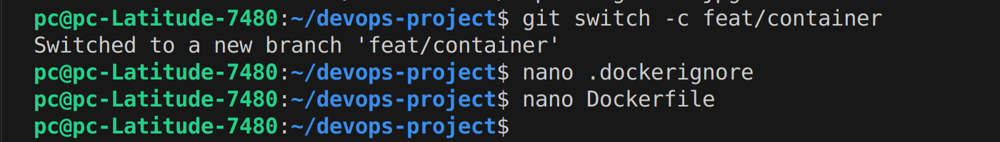
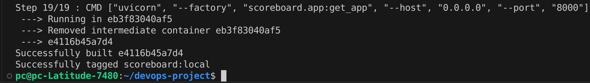

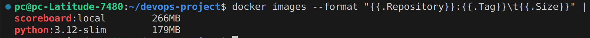

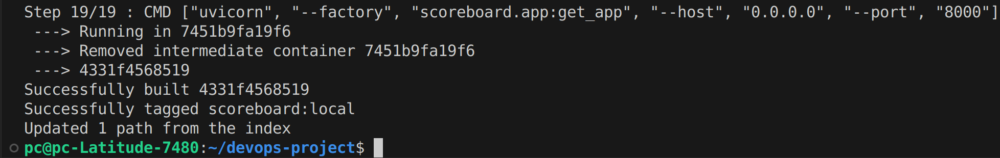

#### Part B:
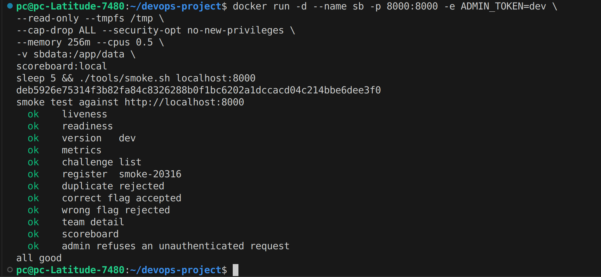
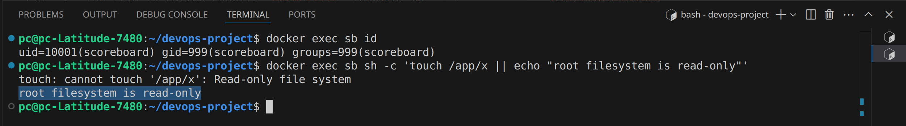

#### Part C:
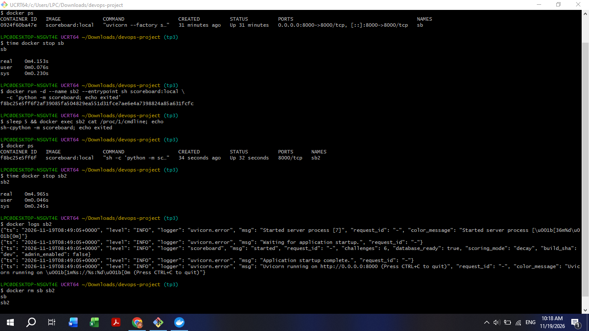
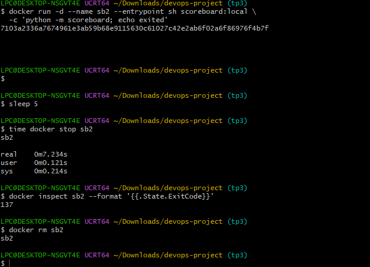

#### Part D:
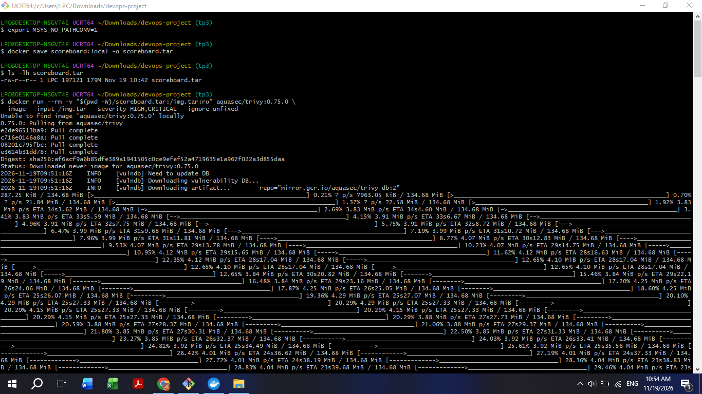

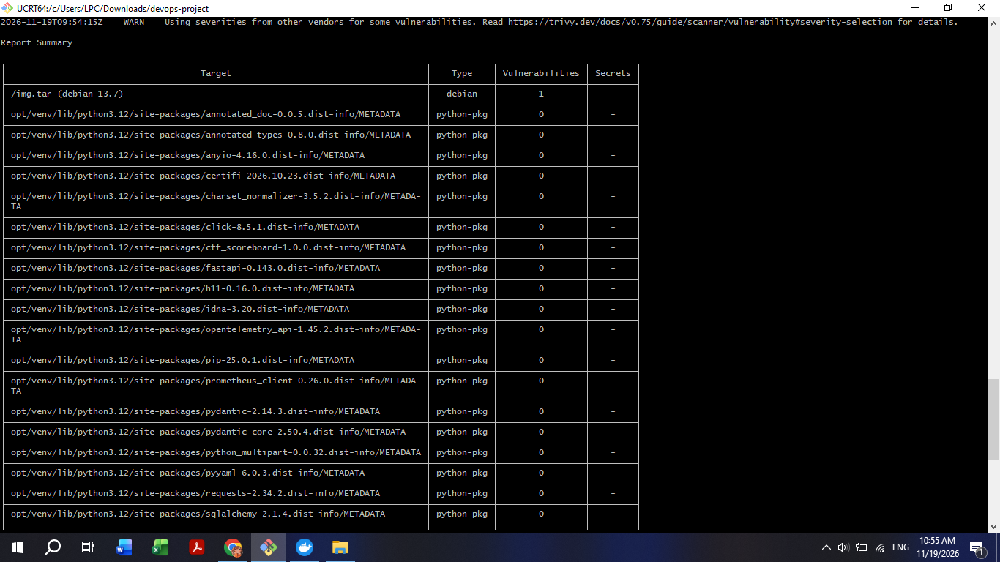

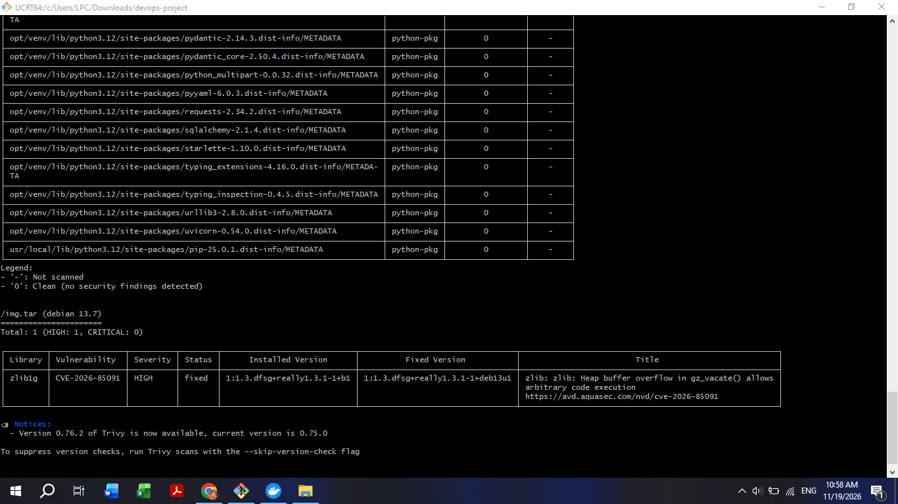

#### Part E:
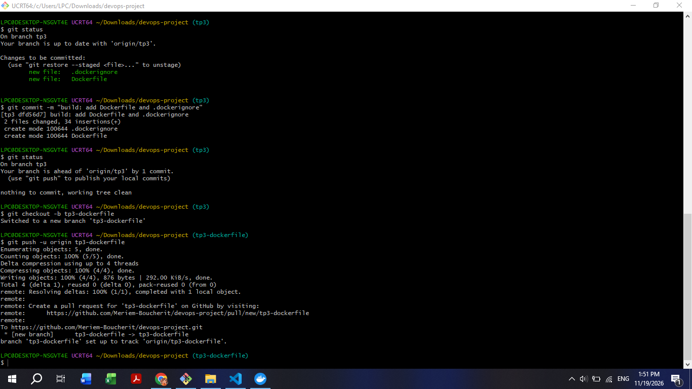

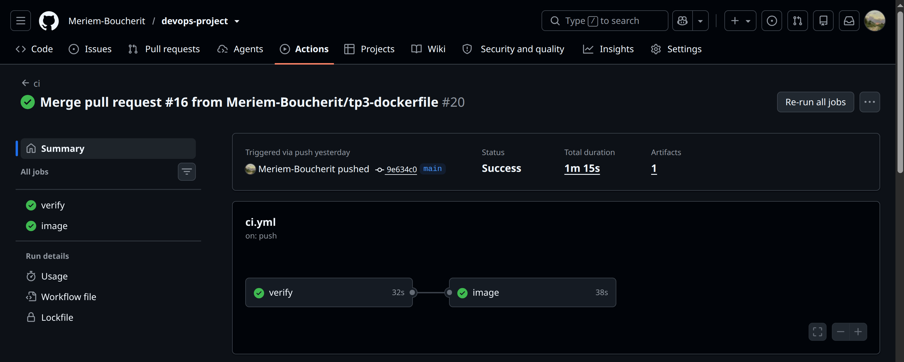

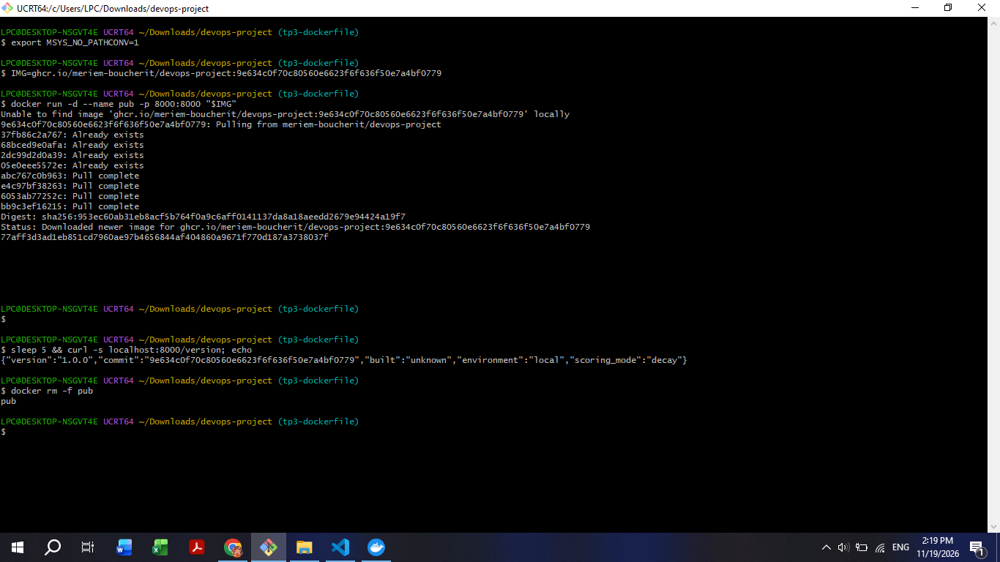

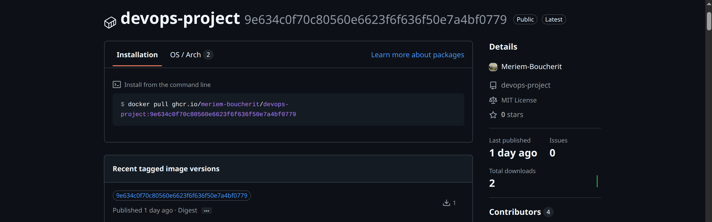

